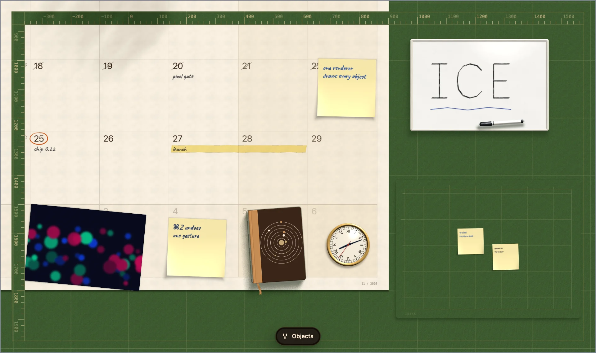
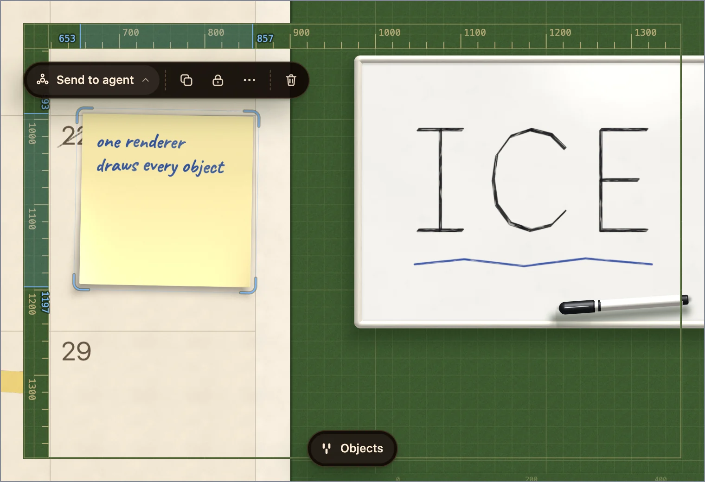
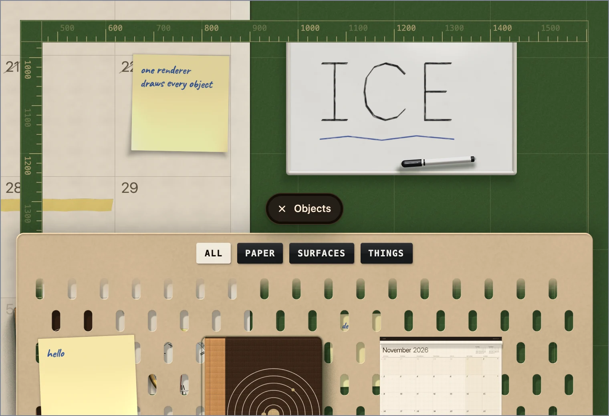
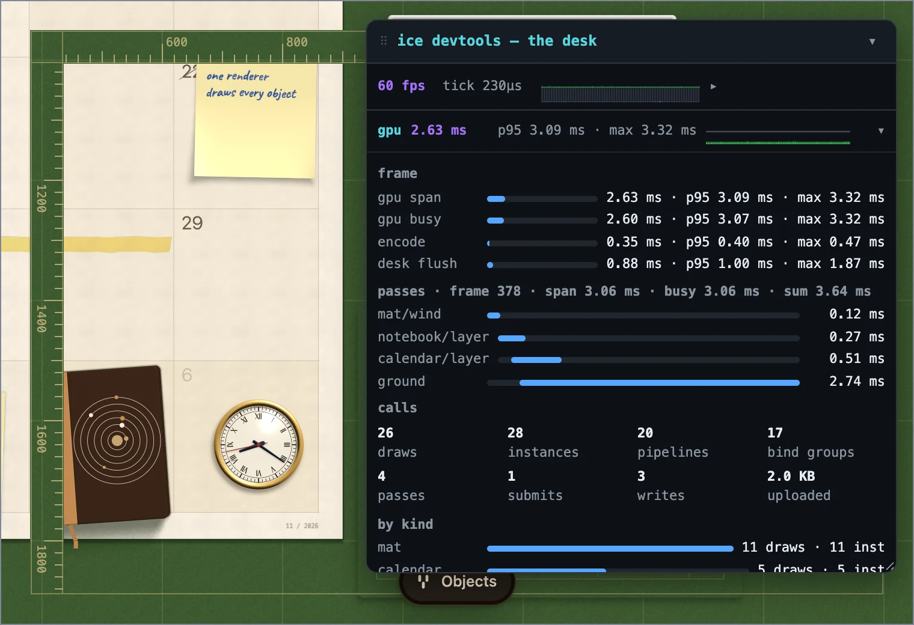
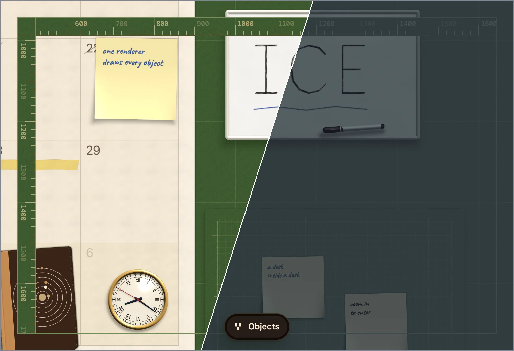
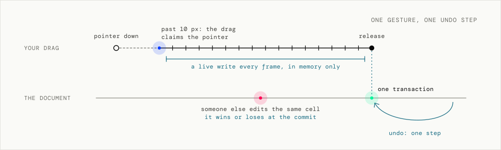
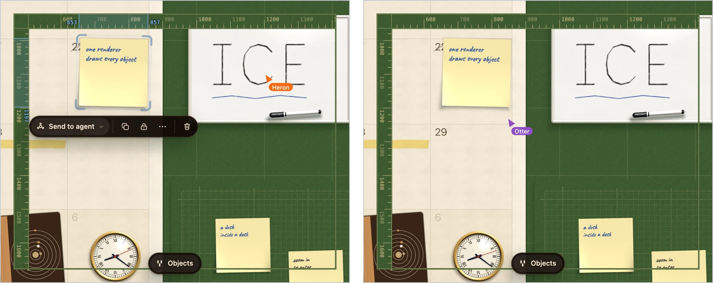

<p align="center">
  <a href="https://vibefield.github.io/infinite-canvas-engine/">
    <picture>
      <source media="(prefers-color-scheme: dark)" srcset=".github/readme/hero-dark.svg">
      
    </picture>
  </a>
</p>

<p align="center">
  <b>ICE is the infinite canvas engine: a framework for canvas apps.</b><br>
  You define the kinds of object. ICE makes them selectable, movable, resizable, nestable,<br>
  shared between people, and undoable one gesture at a time.
</p>

<p align="center">
  <a href="https://vibefield.github.io/infinite-canvas-engine/"><b>Docs</b></a>&nbsp;&nbsp;·&nbsp;
  <a href="https://vibefield.github.io/infinite-canvas-engine/api.html">API</a>&nbsp;&nbsp;·&nbsp;
  <a href="docs/benchmarks.md">Benchmarks</a>&nbsp;&nbsp;·&nbsp;
  <a href="https://www.npmjs.com/package/@vibecook/ice">npm</a>&nbsp;&nbsp;·&nbsp;
  <a href="CHANGELOG.md">Changelog</a>
</p>

<p align="center">
  <a href="https://github.com/vibefield/infinite-canvas-engine/actions/workflows/ci.yml"><picture><source media="(prefers-color-scheme: dark)" srcset="https://img.shields.io/github/actions/workflow/status/vibefield/infinite-canvas-engine/ci.yml?branch=main&label=ci&style=flat-square&labelColor=212437&color=e6eafb"></picture></a>
  <a href="https://www.npmjs.com/package/@vibecook/ice"><picture><source media="(prefers-color-scheme: dark)" srcset="https://img.shields.io/npm/v/%40vibecook%2Fice?label=npm&style=flat-square&labelColor=212437&color=e6eafb"></picture></a>
  <a href="LICENSE"><picture><source media="(prefers-color-scheme: dark)" srcset="https://img.shields.io/badge/license-MIT-e6eafb?style=flat-square&labelColor=212437"></picture></a>
</p>

<br>

<p align="center">
  
</p>

<p align="center"><sub>The showcase in <a href="apps/desk"><code>apps/desk</code></a>: the six reference kinds and a plugin's clock, every one drawn from the world by the desk's WebGPU renderer. A screenshot, not a mock.</sub></p>

## Start

```sh
pnpm add @vibecook/ice react react-dom
```

```tsx
import { createCanvasEngine } from "@vibecook/ice";
import { deskLayer, inkRaster, penFaces } from "@vibecook/ice/desk";
import { DESK_ENGINE, DESK_OBJECTS, deskPalette, deskTheme } from "@vibecook/ice/desk/objects";
import { Desk, EngineProvider } from "@vibecook/ice/react";

// The preset: the six reference kinds and the select tool. A bare-mat drag marquees
// (shift adds), two-axis scroll pans, pinch or Cmd/Ctrl-wheel zooms about the pointer,
// and zooming into a mini mat enters it.
const engine = createCanvasEngine(DESK_ENGINE);
engine.docs.create(); // a local-first document; .open() loads one, .join() shares one

// The desk arrives as one opaque layer. Memoize it: a new identity remounts the canvas.
const layer = deskLayer({
  theme: deskTheme("light"),
  palette: deskPalette("light"),
  objects: [...DESK_OBJECTS],
  docs: engine.docs,
  // your URLs for the handwriting fonts (Caveat and Kalam, OFL; copies in apps/desk/assets/fonts)
  text: inkRaster({
    faces: penFaces({ caveat: caveatUrl, "caveat-bold": caveatBoldUrl, kalam: kalamUrl }),
  }),
});

root.render(
  <EngineProvider engine={engine}>
    <Desk engine={engine} layer={layer} />
  </EngineProvider>,
);

engine.ops.spawnWidget("desk.note", { x: 120, y: 120, props: { text: "hello" } });
```

`react` and `react-dom` are optional peers: the engine is headless, and `createDeskHost` mounts the desk without React. The desk itself needs a browser with WebGPU. [`apps/desk/src/App.tsx`](apps/desk/src/App.tsx) is the worked example.

## What you get

<table>
  <tr>
    <td width="50%" valign="top">
      <br>
      <b>Selection, drawn by the desk</b><br>
      Brackets, the selection's extent on the rulers, and a menu that rides it. Your own acts sit beside the built-in ones.
    </td>
    <td width="50%" valign="top">
      <br>
      <b>A drawer of kinds</b><br>
      Every registered kind hangs on the pegboard, plugins included. Drag one out to set it down.
    </td>
  </tr>
  <tr>
    <td width="50%" valign="top">
      <br>
      <b>It shows its work</b><br>
      One dock for the ECS profiler and the GPU: time per pass, draws per kind, memory per kind.
    </td>
    <td width="50%" valign="top">
      <br>
      <b>Day and night</b><br>
      One call relights the whole desk. This picture is two captures of one view, joined on a slant.
    </td>
  </tr>
</table>

Also: desks inside desks (a mini mat is a container you zoom into), versioned documents with autosave and migration, a keymap, and React hooks for selection, undo and the people in the room.

## How it works

**Everything is world state.** Your objects are entities in one ECS, and so are the pointer, the gesture in progress, the selection and the camera. Nothing hides in a closure, so devtools and collaboration see all of it. Where a thing lives is decided when it is spawned: durable things go in the document, runtime things end with the session, ephemeral things ride presence.

### One frame

<p align="center">
  <picture>
    <source media="(prefers-color-scheme: dark)" srcset=".github/readme/frame-dark.svg">
    
  </picture>
</p>

Systems never touch output, and reflectors never write the world. The phase order is the only ordering contract, and it is why a pointer event reaches its gesture's first write with no added frames.

### One gesture, one undo step

<p align="center">
  <picture>
    <source media="(prefers-color-scheme: dark)" srcset=".github/readme/gesture-dark.svg">
    
  </picture>
</p>

A drag writes live under a claim and commits once, when you let go. If someone else changes the same cell meanwhile, their edit wins or loses at that commit: divergence is the signal, not an error.

## Together

<p align="center">
  
</p>

<p align="center"><sub>Two desks in one room, each drawing the other's hand. Two tabs of the showcase with <code>?room=</code>, over a BroadcastChannel.</sub></p>

```ts
import { webSocketByteChannel } from "@vibecook/ice";

const { role } = await engine.docs.join(webSocketByteChannel(ws), {
  presence: { name: "Otter", color: "#8e4ec6" },
});
// "seeder" arrived first and seeds the board; a "joiner" receives it
```

The app moves bytes and the engine owns the protocol. Documents and presence are [Loro](https://loro.dev) CRDTs, through [`@vibecook/strata-ecs`](https://github.com/vibefield/strata-ecs), the ECS underneath.

## Your own kind

`defineObject` is how a new kind joins the desk. A kind is three things: a program that draws its records, a CPU mirror that answers "what is under this point", and the behaviours that change it.

The six reference kinds (note, mini mat, notebook, whiteboard, calendar, photo) are built on the public entry points alone, exactly as a plugin is. [`examples/desk-clock`](examples/desk-clock) is a complete plugin in a package of its own: the clock in the picture above, with its own shader, its tray entry, its menu act and its wake once a second.

```ts
import { DESK_CLOCK_OBJECTS } from "@ice-examples/desk-clock"; // a workspace package in this repo

const engine = createCanvasEngine({
  ...DESK_ENGINE,
  widgets: [...DESK_ENGINE.widgets, ...DESK_CLOCK_OBJECTS],
});
```

## Run the showcase

```sh
pnpm install
pnpm --filter desk dev
```

| Key | Does |
| --- | --- |
| `w` · `m` · `b` | a note, a mini mat, a notebook |
| `⇧W` · `⇧C` · `c` | a whiteboard, a calendar, the plugin's clock |
| `a` | the pegboard drawer |
| `d` · `u` | day or night, the rulers |
| `` ` `` · `~` | the dev panel, the devtools dock |
| `⌘Z` · `⇧⌘Z` | undo and redo, one gesture at a time |

Paste or drop a picture and it becomes a print. Add `?room=x` to share a desk between two tabs. For two machines, run `RELAY_HOST=0.0.0.0 pnpm relay` on one and add `&relay=ws://<its address>:9301` on both.

## Limits

Measured, not estimated. [`docs/benchmarks.md`](docs/benchmarks.md) has the method and the full output, from an Apple M1 Max in July 2026. Some sections were measured on the presentation the desk replaced, and are marked historical there.

- **Shared boards: plan around 3,000 objects.** A peer who is editing applies an incoming edit at a cost that grows with the document. A peer who only receives holds to about 40,000, and a local document to about 100,000.
- **Scale through containers, not flat boards.** A flat board with 100,000 active objects costs 40 to 64 ms per camera-gesture frame. Nested, the same count costs 2.6 to 4.4 ms.
- **Opening a big document is a one-time cost:** 0.3 to 0.5 s at 10,000 rows, 3.2 to 3.9 s at 100,000. A saved document is about 100 bytes a row.
- **Out of scope, each with a named seam:** a general layout engine, rich text, comments and permissions. There is no authority model, so trust between users is the app's to own.
- **Not yet on the desk:** the string between objects (no kind declares a port yet), and which mat another person is inside.
- **Pre-1.0,** and so is strata-ecs underneath. Minor versions may break APIs.

## Entry points

One npm package, nine entry points. Import walls between them are enforced by dependency-cruiser and fail CI.

| Import | What |
| --- | --- |
| `@vibecook/ice` | The engine: the ECS catalog, the frame, interaction, documents, presence, `createCanvasEngine` |
| `@vibecook/ice/kernel` | Pure math: coordinates, snap, the spatial index, easings |
| `@vibecook/ice/dom` | Screen space only: the host, the pointer adapter, the frame loop, cursors, `createDeskHost` |
| `@vibecook/ice/desk` | The desk: the WebGPU renderer, `deskLayer`, and the kind contract (`defineObject`) |
| `@vibecook/ice/desk/engine` | The raw WebGPU layer: device, shader composition, pipelines, render targets |
| `@vibecook/ice/desk/kit` | What a kind's pass is written against: the view, the light, the shared WGSL |
| `@vibecook/ice/desk/objects` | The six reference kinds, the preset (`DESK_ENGINE`) and the default palette |
| `@vibecook/ice/react` | `<Desk>`, `EngineProvider`, hooks, the keymap, the selection menu |
| `@vibecook/ice/devtools` | `attachDevtools(engine)`: the profiler, the observer and the GPU in one dock |

<details>
<summary><b>Development</b></summary>

<br>

Node 24 and pnpm 11.

```sh
pnpm install
pnpm run ci            # typecheck, lint, tests, import walls, generated-file checks: the merge gate
pnpm run gate:landing  # the pixel gate: the Dawn oracle, the desk's Dawn units, the apps/desk build and its twenty-one rigs
```

`ci` is the merge gate. `gate:landing` is required at every landing and is kept out of `ci` because its oracle needs Dawn. The rigs drive headless Chrome against the oracle's bytes, and `rig:parity` holds every scene to a difference of zero.

- [`docs/implementation-plan.md`](docs/implementation-plan.md) tracks the milestones and their exit criteria.
- Every counterintuitive behaviour is a cited decision. Check the design record before "fixing" one.
- Asks against strata-ecs are petitions: [`docs/strata-petitions.md`](docs/strata-petitions.md).
- Documents written by 0.1.0 migrate on open.

</details>

<br>

<p align="center">
  <a href="https://github.com/vibefield">
    <picture>
      <source media="(prefers-color-scheme: dark)" srcset=".github/readme/vibefield-dark.svg">
      
    </picture>
  </a>
</p>

<p align="center">
  <sub><a href="LICENSE">MIT</a> © 2026 James Yong. ICE is the canvas engine of <a href="https://github.com/vibefield/vibefield">VibeField</a>, built on <a href="https://github.com/vibefield/strata-ecs">strata-ecs</a>.</sub>
</p>
